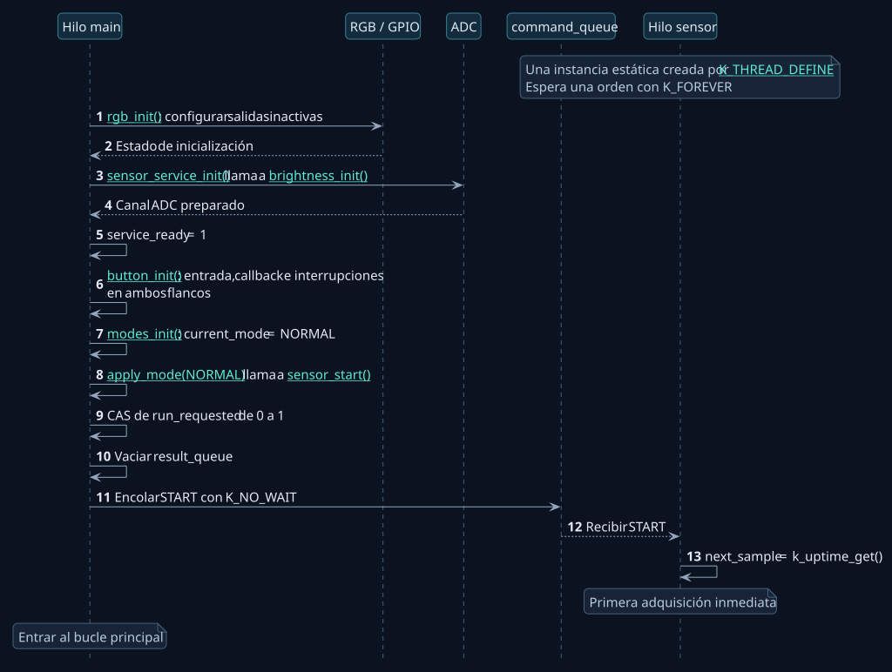
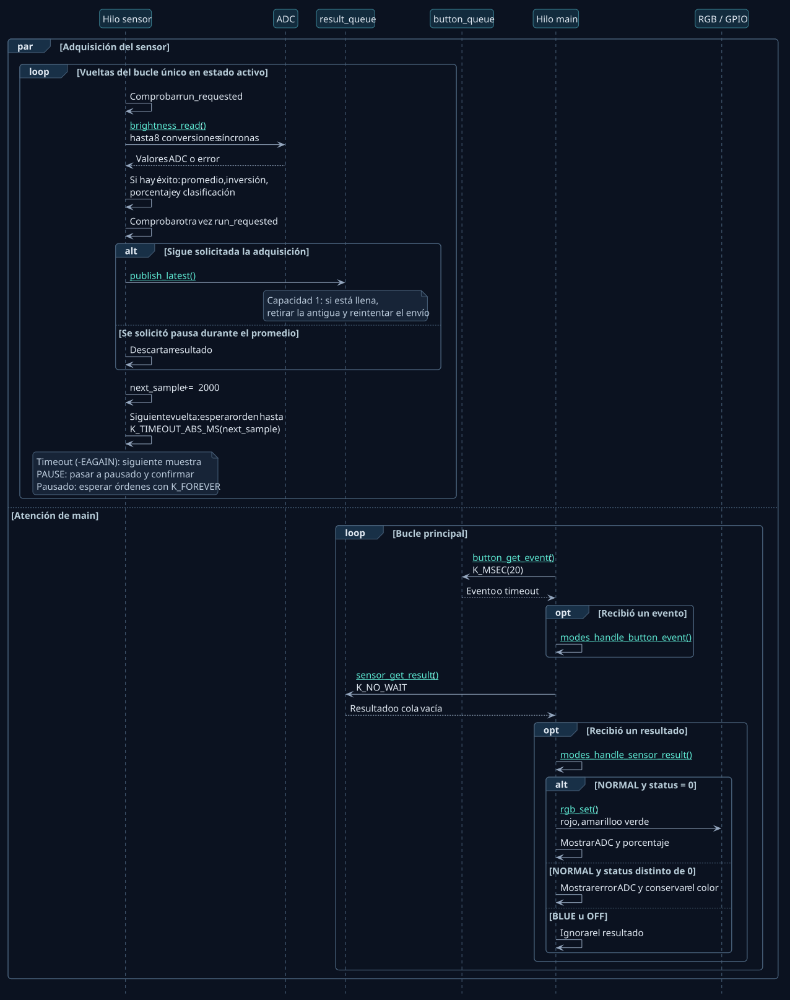
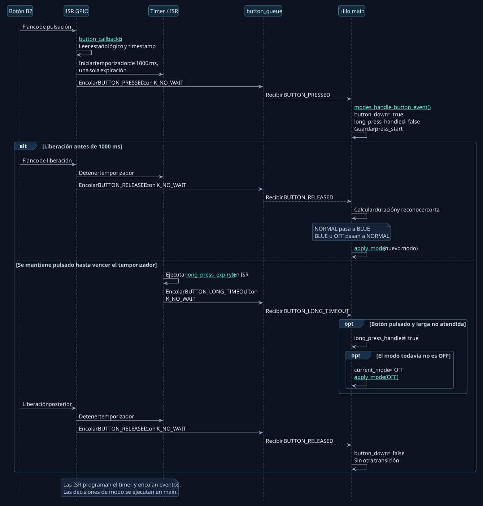
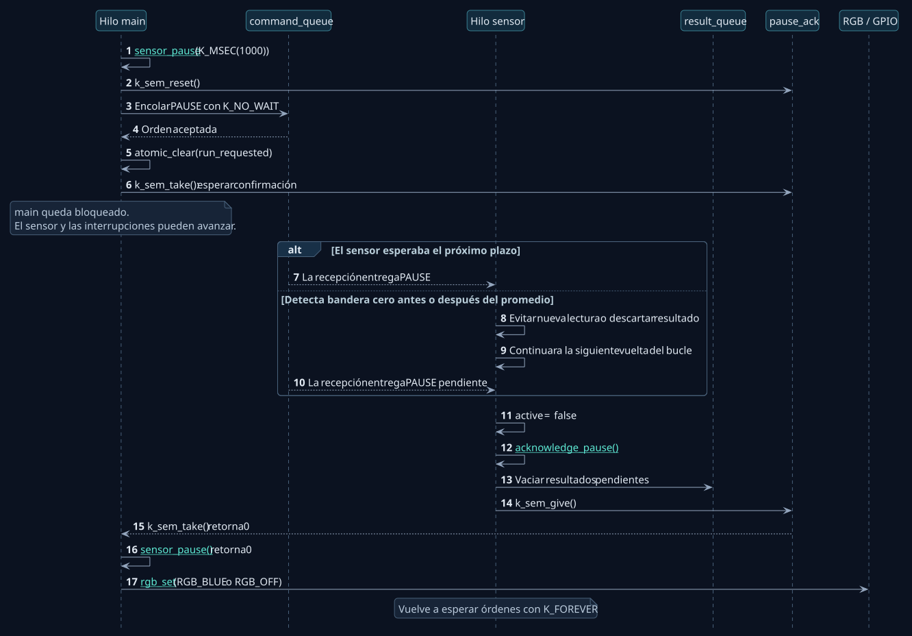

# Secuencias del firmware original

El firmware comprende cuatro secuencias principales:

| Secuencia | Comportamiento documentado |
| --- | --- |
| [Arranque](#arranque) | Inicialización del hardware y solicitud de la primera lectura |
| [Muestreo](#muestreo) | Adquisición del ADC, procesamiento de la muestra y actualización del RGB |
| [Botón](#boton) | Entrega de eventos desde las interrupciones y transición de modos |
| [Pausa](#pausa) | Detención de la adquisición y confirmación al hilo principal |

Las fuentes PlantUML definen las cuatro secuencias. Las vistas HTML incorporan
los SVG y sus enlaces a las funciones del código. Las imágenes de este
documento son vistas previas de esas mismas secuencias.

Las columnas verticales representan participantes: hilos, módulos, colas o
periféricos. **Una columna no implica un hilo nuevo.** Las llamadas a `modes.c`
y a las API públicas del sensor se ejecutan en el hilo que las llama, aquí
`main`. Las flechas continuas representan llamadas o entregas; las discontinuas,
retornos o recepción. `alt` separa alternativas, `opt` una condición opcional,
`loop` una repetición y `par` actividades que progresan de forma concurrente.
En este microcontrolador, los hilos comparten la CPU mediante el planificador.

## 1. Arranque

El hilo del sensor existe desde `K_THREAD_DEFINE`, pero espera una orden.
Inicializar el servicio prepara el ADC; solicitar START permite adquirir.

[Vista interactiva](diagrams/arranque.html) · [Fuente PlantUML](diagrams/arranque.puml)

Este es el camino de éxito. Si fallan `rgb_init()`, `sensor_service_init()` o
`button_init()`, `main` imprime el error y termina. START no crea otro hilo.
Su operación CAS evita duplicar la orden si ya se ha solicitado adquirir;
si falla el envío de START, revierte `run_requested` a cero.

Entrar en NORMAL no escribe inmediatamente un color: solicita el sensor.
La primera muestra válida determina el RGB. Al regresar desde BLUE puede
mantenerse azul hasta que esa muestra sea atendida.

## 2. Muestreo y actualización del RGB

El sensor produce una estructura `sensor_result` que incluye el estado de
la lectura y la muestra. La cola copia esa estructura; no transporta un
puntero a una variable local. Los errores del ADC también se publican.

[Vista interactiva](diagrams/muestreo.html) · [Fuente PlantUML](diagrams/muestreo.puml)

El promedio es entero: `adc_raw = suma / 8`. Para este circuito, más luz
reduce el ADC, por eso `brillo = 4095 - adc_raw` con resolución de 12 bits.
El porcentaje mostrado se redondea. El color se decide **antes** de ese
redondeo, comparando el brillo con los límites del 33 % y 66 % mediante
productos de 64 bits. Los límites exactos pertenecen a amarillo; por debajo
es rojo y por encima es verde. Es brillo relativo, no una medida en lux.

El plazo absoluto avanza desde el objetivo anterior. Si una adquisición
tardase 80 ms dentro de un período de 2000 ms, quedarían aproximadamente
1920 ms hasta el próximo objetivo; la ejecución real depende también del
planificador. No se añade sistemáticamente el tiempo de adquisición al período.

`main` espera primero **hasta** 20 ms por un botón y después consulta la cola
de resultados sin esperar. Una muestra no despierta por sí sola esa espera
del botón. Se atiende un mensaje de cada cola por vuelta. Si un manejador,
como el de pausa, bloquea `main`, puede añadirse más latencia.

`rgb_set()` escribe los tres canales de forma consecutiva y conserva el primer
error. El valor lógico uno enciende: `gpio_pin_set_dt()` traduce la polaridad
`GPIO_ACTIVE_LOW` para el RGB de ánodo común.

## 3. Botón, temporizador y modos

La interrupción GPIO y la expiración del temporizador publican eventos.
La decisión de modo sucede al consumirlos en `main`. El temporizador no
crea un hilo de aplicación: su función de expiración se ejecuta en ISR.

[Vista interactiva](diagrams/boton.html) · [Fuente PlantUML](diagrams/boton.puml)

El diagrama supone que los eventos se entregan correctamente. La cola tiene
ocho posiciones; las ISR usan `K_NO_WAIT` e ignoran errores de envío. Por tanto,
un evento puede perderse si está llena. Detener el temporizador tampoco
elimina un evento de expiración que ya estuviera encolado.

La liberación también permite reconocer una pulsación larga: si su timestamp
indica al menos 1000 ms y aún no se atendió la larga, se activa OFF aunque
faltara `BUTTON_LONG_TIMEOUT`. Este respaldo no cubre todos los eventos
perdidos: sin PRESSED registrado se ignora RELEASED.

| Modo actual | Corta al liberar | Larga reconocida |
| --- | --- | --- |
| NORMAL | BLUE | OFF |
| BLUE | NORMAL | OFF |
| OFF | NORMAL | Mantener OFF |

Soltar después de una larga atendida no produce una corta. La bandera
`long_press_handled` impide esa segunda transición.

## 4. Pausa confirmada antes de BLUE u OFF

Esta secuencia muestra una solicitud sobre un sensor activo y una confirmación
recibida dentro del plazo. La llamada se ejecuta en `main`.

[Vista interactiva](diagrams/pausa.html) · [Fuente PlantUML](diagrams/pausa.puml)

La coordinación entre `main` y el sensor utiliza estos mecanismos:

| Mecanismo | Responsabilidad |
| --- | --- |
| `command_queue`, capacidad 1 | Entregar START o PAUSE al sensor |
| `run_requested`, atómico | Expresar si se sigue solicitando adquisición |
| `pause_ack`, semáforo 0/1 | Confirmar que el sensor atendió la pausa y limpió resultados |
| `result_queue`, capacidad 1 | Entregar el último resultado al consumidor |

La bandera no cancela una conversión en curso. Si la pausa llega durante
`brightness_read()`, termina esa llamada y se descarta su resultado.
El semáforo bloquea al llamador que espera la confirmación; no bloquea al
sensor que debe producirla. Si `give` ocurre antes de `take`, queda disponible
una ficha y la recepción puede completarse sin esperar.

### Casos de retorno y tratamiento de errores

- Si `run_requested` ya es cero al entrar en `sensor_pause()`, retorna cero
  directamente: esa rama no espera una confirmación nueva.
- Si falla el envío de PAUSE, la función devuelve el error sin ejecutar
  la limpieza posterior de la bandera ni esperar el semáforo.
- Si vence el plazo del semáforo, se devuelve el error. Las acciones de BLUE
  y OFF lo imprimen y **aplican el color igualmente**; no revierten el modo.
  En esa rama, el retorno no confirma que el sensor haya completado la pausa.
- En BLUE y OFF, el gestor ignora el efecto de los resultados recibidos.
  Esa protección del color es independiente de que la adquisición esté pausada.
- OFF es un modo lógico: el RGB se apaga y se solicita pausar la adquisición.
  El firmware sigue atendiendo B2. No equivale a cortar la alimentación del MCU.

## Referencias al código

La tabla relaciona las operaciones descritas con sus archivos y líneas de
implementación.

<!-- firmware-source-index:start -->

| Paso | Punto del recorrido | Codigo original |
| --- | --- | --- |
| 1 | 01 · Arranque y orden de inicialización | [`src/main.c:13`](../src/main.c#L13) |
| 2 | 02 · Preparar las salidas RGB | [`src/rgb_led.c:26`](../src/rgb_led.c#L26) |
| 3 | 03 · Preparar ADC y marcar el servicio disponible | [`src/sensor_thread.c:116`](../src/sensor_thread.c#L116) |
| 4 | 04 · Un hilo sensor durante toda la aplicación | [`src/sensor_thread.c:113`](../src/sensor_thread.c#L113) |
| 5 | 05 · Registrar el botón y habilitar sus flancos | [`src/button.c:47`](../src/button.c#L47) |
| 6 | 06 · NORMAL es el modo inicial | [`src/modes.c:104`](../src/modes.c#L104) |
| 7 | 07 · START: CAS, una orden y posible reversión | [`src/sensor_thread.c:131`](../src/sensor_thread.c#L131) |
| 8 | 08 · main atiende primero un evento del botón | [`src/main.c:43`](../src/main.c#L43) |
| 9 | 09 · main consulta después el resultado ADC | [`src/main.c:53`](../src/main.c#L53) |
| 10 | 10 · Un resultado transporta estado y muestra | [`include/sensor_service.h:10`](../include/sensor_service.h#L10) |
| 11 | 11 · START despierta al sensor y permite la primera lectura | [`src/sensor_thread.c:66`](../src/sensor_thread.c#L66) |
| 12 | 12 · Ocho conversiones construyen una muestra | [`src/brightness.c:39`](../src/brightness.c#L39) |
| 13 | 13 · Invertir el ADC y mostrar un porcentaje | [`src/brightness.c:87`](../src/brightness.c#L87) |
| 14 | 14 · Clasificar antes del redondeo | [`src/brightness.c:15`](../src/brightness.c#L15) |
| 15 | 15 · Publicar la muestra más reciente | [`src/sensor_thread.c:24`](../src/sensor_thread.c#L24) |
| 16 | 16 · Esperar una orden hasta un instante absoluto | [`src/sensor_thread.c:92`](../src/sensor_thread.c#L92) |
| 17 | 17 · Solo NORMAL permite que la muestra cambie el RGB | [`src/modes.c:170`](../src/modes.c#L170) |
| 18 | 18 · Colores lógicos y errores de GPIO | [`src/rgb_led.c:48`](../src/rgb_led.c#L48) |
| 19 | 19 · La interrupción registra presión o liberación | [`src/button.c:19`](../src/button.c#L19) |
| 20 | 20 · El temporizador avisa mientras se mantiene pulsado | [`src/button.c:86`](../src/button.c#L86) |
| 21 | 21 · Guardar el comienzo de una pulsación | [`src/modes.c:122`](../src/modes.c#L122) |
| 22 | 22 · Resolver la larga antes de soltar | [`src/modes.c:128`](../src/modes.c#L128) |
| 23 | 23 · Liberar: corta, larga de respaldo o ninguna acción | [`src/modes.c:146`](../src/modes.c#L146) |
| 24 | 24 · BLUE espera la pausa antes de escribir el color | [`src/modes.c:46`](../src/modes.c#L46) |
| 25 | 25 · Solicitar PAUSE y bloquear únicamente al llamador | [`src/sensor_thread.c:154`](../src/sensor_thread.c#L154) |
| 26 | 26 · Una pausa durante el promedio descarta el resultado | [`src/sensor_thread.c:79`](../src/sensor_thread.c#L79) |
| 27 | 27 · Entregar la confirmación después de limpiar | [`src/sensor_thread.c:37`](../src/sensor_thread.c#L37) |
| 28 | 28 · OFF lógico y vuelta a NORMAL | [`src/modes.c:64`](../src/modes.c#L64) |

<!-- firmware-source-index:end -->
